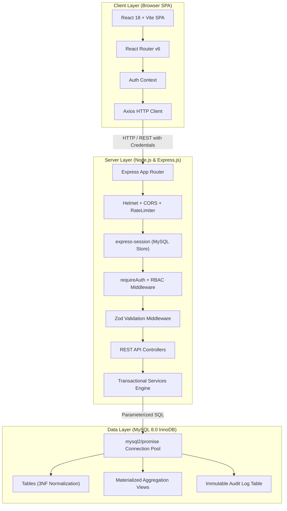
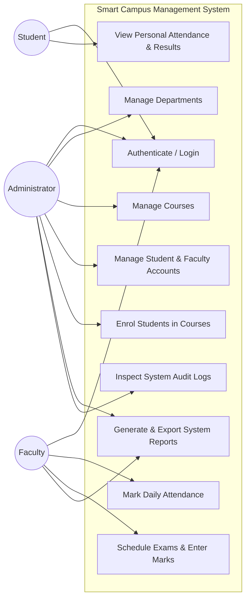
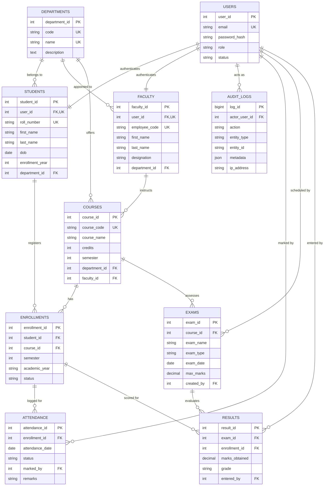
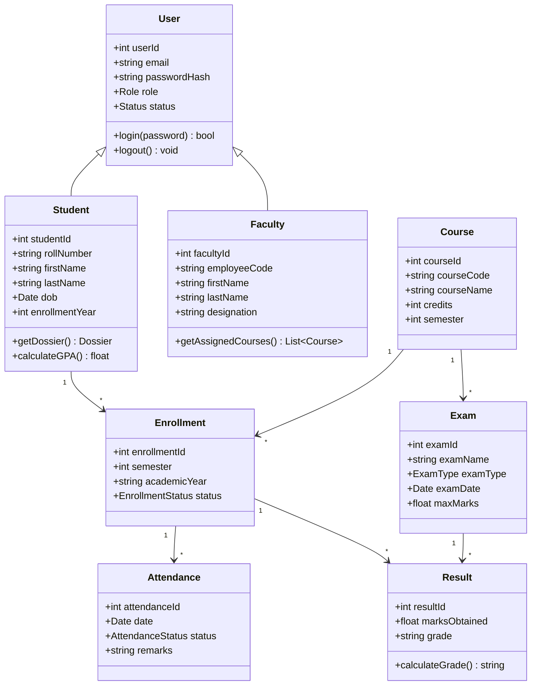
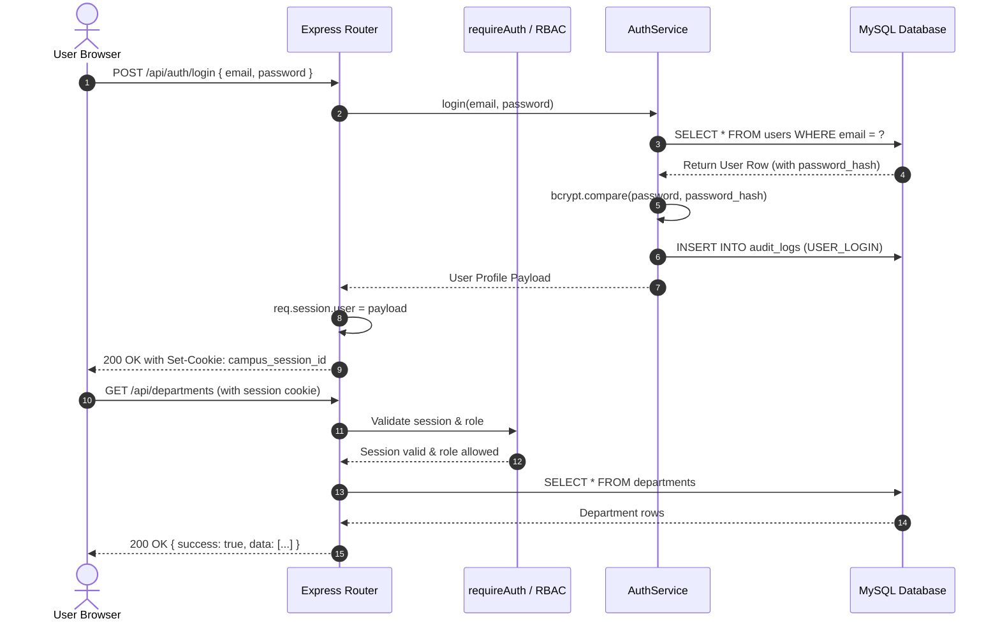
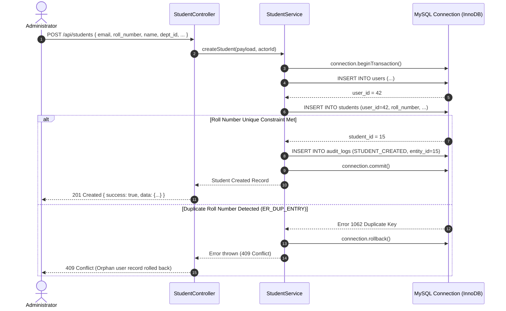
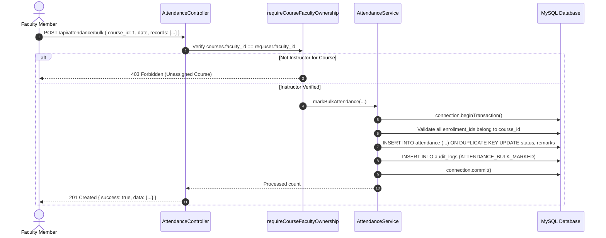
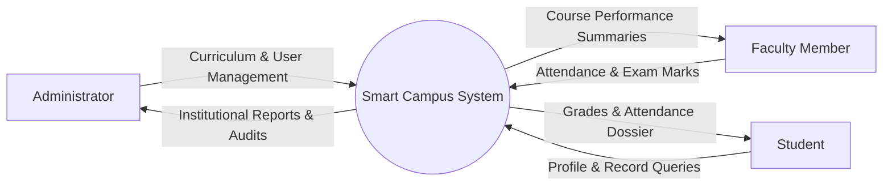
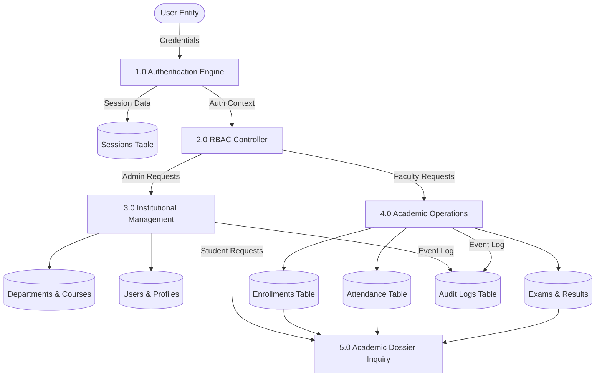

# System Design & Architecture Diagrams
## Smart Campus Management System

---

## 1. System Architecture Diagram



---

## 2. Use-Case Diagram



---

## 3. Entity-Relationship (ER) Diagram (Crow's Foot Notation)



---

## 4. Relational Schema Mapping (Table Invariants)

```
DEPARTMENTS (department_id [PK], code [UK], name [UK], description, created_at, updated_at)

USERS (user_id [PK], email [UK], password_hash, role, status, created_at, updated_at)

STUDENTS (student_id [PK], user_id [FK->USERS, UK], roll_number [UK], first_name, last_name, 
          dob, phone, address, enrollment_year, department_id [FK->DEPARTMENTS], created_at, updated_at)

FACULTY (faculty_id [PK], user_id [FK->USERS, UK], employee_code [UK], first_name, last_name, 
         designation, phone, department_id [FK->DEPARTMENTS], created_at, updated_at)

COURSES (course_id [PK], course_code [UK], course_name, credits, semester, 
         department_id [FK->DEPARTMENTS], faculty_id [FK->FACULTY, NULLABLE], created_at, updated_at)

ENROLLMENTS (enrollment_id [PK], student_id [FK->STUDENTS], course_id [FK->COURSES], semester, 
             academic_year, status, created_at, UNIQUE(student_id, course_id, semester, academic_year))

ATTENDANCE (attendance_id [PK], enrollment_id [FK->ENROLLMENTS], attendance_date, status, 
            marked_by [FK->USERS], remarks, created_at, updated_at, UNIQUE(enrollment_id, attendance_date))

EXAMS (exam_id [PK], course_id [FK->COURSES], exam_name, exam_type, exam_date, max_marks, 
       created_by [FK->USERS], created_at, updated_at, UNIQUE(course_id, exam_name))

RESULTS (result_id [PK], exam_id [FK->EXAMS], enrollment_id [FK->ENROLLMENTS], marks_obtained, 
         grade, entered_by [FK->USERS], created_at, updated_at, UNIQUE(exam_id, enrollment_id))

AUDIT_LOGS (log_id [PK], actor_user_id [FK->USERS], action, entity_type, entity_id, 
            metadata [JSON], ip_address, created_at)
```

---

## 5. UML Class Diagram



---

## 6. Sequence Diagrams

### 6.1 Authentication & RBAC Verification Sequence


### 6.2 Transactional Student Registration Sequence


### 6.3 Bulk Attendance Marking Sequence


---

## 7. Data Flow Diagrams (DFD)

### 7.1 Level-0 Context DFD


### 7.2 Level-1 Detailed DFD


